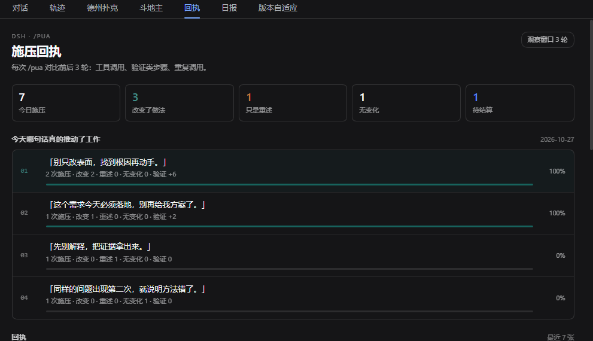
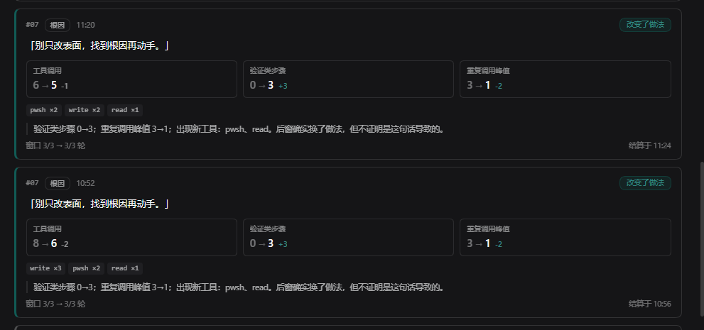

# dsh-pua-receipt

[](https://github.com/dingchenhui0618-arch/dsh-pua-receipt/actions/workflows/ci.yml)
[](LICENSE)

给 DeepSeek Harness 的 `/pua` 加一张**回执**：每次施压都对比前后各 N 轮的工具调用、验证类步骤和重复调用，判定它是「改变了做法 / 只是重述 / 无变化」，并在会话结束时给出「今天哪句话真的推动了工作」的排行。

> 它不证明因果。它只把「这句话到底有没有让 agent 换做法」变成可复核的前后差异。

## 它解决什么

原来的 PUA 类插件有 15 套公司话术和一个可选的循环施压，但没有任何效果度量：你施压了，agent 可能真的去写测试了，也可能只是换了一段更客气的说法，再把同一件事重做一遍。两种情况下，聊天记录看起来都很像。

这个插件把每次 `/pua` 变成一次小实验：

1. `/pua` 把一句压力话术作为真实的 steer 消息送进当前会话；
2. 记录施压前最后 N 个完整模型步，以及施压后接下来 N 个完整模型步；
3. 每个窗口统计：工具调用数、验证类步骤数、重复调用峰值、失败调用数、助手文本长度；
4. 窗口走满后写一张回执，并给出三分类判定；
5. 当天所有完成的回执按话术聚合，排出「哪句话真的推动了工作」。

## 灵感与原版差异

灵感来自 **[michengai/dsh-pua](https://github.com/michengai/dsh-pua)**（Apache-2.0）。本项目是**独立实现**：没有 fork、没有 clone 后改写、没有复制原版的代码或话术文案。15 条中文话术是 `src/library.js` 里本项目自己写的句子。

| | 原版 dsh-pua | dsh-pua-receipt |
|---|---|---|
| 核心能力 | 15 套公司话术，可选循环施压 | 同样是施压，但每次施压都产出可对比的前后指标 |
| 效果度量 | 无 | 前 N 轮 vs 后 N 轮：工具调用、验证类步骤、重复峰值、失败调用、文本量 |
| 判定 | 无 | 改变了做法 / 只是重述 / 无变化，附证据说明 |
| 排行 | 无 | 按话术聚合「改变了做法」次数与验证提升，给出当天排行 |
| 数据 | 话术与循环状态 | 回执写入本地 JSONL，面板与 `/pua rank` 可复查 |
| 代码来源 | 原项目 | 从零实现；仅借鉴「给 agent 施压」这一产品思路 |

原版的 LICENSE 是 Apache-2.0；本项目没有复用它的代码，因此使用 MIT。若未来需要复用任何片段，必须先确认许可并在文件里保留原版权声明。

## 怎么算

### 「一轮」是什么

**一轮 = 一个完整模型步**：一次模型请求开始到该步结束。一个步里可以有很多工具调用；它们都算进同一步。这不是「一次用户提问」，因为施压通常发生在 agent 反复失败的过程中，按用户轮次会把大量动作压成一轮，看不出变化。

### 窗口

- **前窗**：执行 `/pua` 时，会话里最后 N 个已完成的步。若不足 N 个，回执会标为「部分」。
- **后窗**：施压消息进入后，接下来 N 个已完成的步。若会话在这之前结束，回执标为「证据不足」，不进排行。
- 默认 N = 3，可用 `/pua --rounds 5` 改（1–12）。

### 验证类步骤

以下调用算「验证类」——它们试图检查结果，而不是继续产出：

- 测试 / 构建 / 类型检查 / lint：`node --test`、`npm test`、`pnpm run build`、`pytest`、`cargo test`、`tsc`、`eslint`…
- 差异与哈希：`git diff`、`git status`、`git show`、`Get-FileHash`、`sha256sum`…
- CI 与本地健康检查：`gh pr checks`、`gh run`、对 `localhost` / `/health` 的 `curl`…
- 读测试、日志、覆盖率产物，或查看截图（`read_image`、`computer screenshot`）。

这是一个启发式分类，不是语义理解；误判是可能的，README 不把它包装成「精确」。

### 三分类判定

窗口走满后，按顺序：

1. **改变了做法**：后窗仍有动作，且满足任一条件——
   - 验证类步骤增加；
   - 重复调用峰值下降（原先同一调用重复 ≥2 次）；
   - 出现前窗没有的新工具，且动作量没有减少；
   - 失败调用从 ≥2 次下降。
2. **只是重述**：后窗动作量 ≤ 前窗的 25%，但产生了 ≥20 字的助手文本。
3. **无变化**：以上都不满足。

判定规则在 `src/metrics.js`，测试在 `test/metrics.test.mjs`，没有隐藏的模型评分。

### 排行

同一天、同一句话的所有完成回执聚合成一行，排序键依次是：

1. 「改变了做法」的次数；
2. 验证类步骤的总提升（只累加正增量）；
3. 施压次数。

排行回答的是「这句话之后观察到行为改变了几次」，**不是**「这句话的因果效果」。样本少、任务不同、模型状态不同，都会影响结果；把排行当参考，不要当 KPI。

## 用法

| 命令 | 作用 |
|---|---|
| `/pua` | 施压一次，自动轮换话术，默认观察后 3 轮 |
| `/pua 7` | 使用第 7 条话术 |
| `/pua evidence` | 按 id 或语气选话术（`/pua list` 查看全部） |
| `/pua --rounds 5` | 这次观察 5 轮（1–12） |
| `/pua status` | 当前实验进度 |
| `/pua receipts` | 最近 5 张回执 |
| `/pua rank` | 今天的按句排行 |
| `/pua list` | 15 条话术 |
| `/pua off` | 取消当前实验（回执标记「已取消」，不参与排行） |

一次典型的回执：

```text
【PUA 回执 rk3f9c2】
「先别解释，把证据拿出来。」
判定：改变了做法（窗口 3/3 → 3/3 轮）
前：工具 12 · 验证 0 · 重复峰值 4
后：工具 9 · 验证 3 · 重复峰值 0
Δ：工具 -3 · 验证 +3
依据：验证类步骤 0→3；重复调用峰值 4→0。后窗确实换了做法，但不证明是这句话导致的。
```

## 安装

插件需要 DeepSeek Harness 0.2.x（`engines.dsh` 为 `>=0.2.1-rc.2 <0.3.0`）。

**桌面版**：打开「插件」→ 安装 → 选择本目录；本机验证就是这样装上的。`desktop` profile 由 Electron 独占，命令行加 `--profile desktop` 会被拒绝，这是宿主的设计。

**Web / CLI**：把本仓库地址作为安装源，或：

```sh
dsh plugin --profile <你的 web profile> add github:dingchenhui0618-arch/dsh-pua-receipt
```

本地开发时用 `plugin_manager` 的 `install_bundle` 指向本目录（Windows 路径示例）：

```text
D:\Projects\dsh-pua-receipt
```

`lib/` 是入库的构建产物，安装时不需要联网构建。装好后重启 DSH，对话视图里出现「回执」Tab；`/pua` 命令由 host 半区注册。

## 面板

对话视图 →「回执」Tab：

- 今日计数：施压次数 / 改变了做法 / 只是重述 / 无变化 / 待结算
- 进行中的实验：当前话术、已收集轮数、前窗指标
- 今日排行：每句话的施压次数、改变/重述/无变化、验证提升
- 回执列表：每张回执的前后指标、判定、证据与窗口完整度





> 两张截图都取自真实运行的 DSH 界面。图中的回执由与 `node --test` 同源的场景脚本生成后写入本地回执文件，用来展示三种判定、排行和待结算状态；它不是某位用户的真实会话记录，也不冒充真实使用数据。

## 数据与隐私

- 回执追加写入 `$DSH_HOME/pua-receipts.jsonl`（默认 `~/.dsh/pua-receipts.jsonl`）。
- 每条回执只保存：时间、话术 id/文案/语气、窗口轮数、聚合后的计数、判定和证据句。
- **不保存**工具参数、命令原文、文件内容、模型回复正文或 session id。
- 插件不发网络请求；排行与面板都读本地文件和内存。

## 它不做什么

- **不证明因果。** 前后差异可能来自任务变化、模型随机性、上下文长度，甚至用户中途插话。回执只陈述窗口里发生了什么。
- **不保证「只是重述」识别准确。** 文本量是启发式；agent 可能用一句话就换了做法，也可能写很多字真的做了事。
- **不替代测试。** 验证类步骤增加，不等于验证真的通过；要看工具结果。
- **不制造证据。** 窗口不满、宿主拒绝消息、服务缺失时，回执会标为「证据不足」「已取消」或明确报错，而不是补一句结论。

## 开发

```sh
node scripts/build.mjs   # 零依赖构建，产出 lib/
node --test              # 38 个测试
```

测试分两组：

- `metrics.test.mjs`：话术库、验证分类、签名归一化、聚合、三分类、排行、格式化。
- `host.test.mjs`：用 stub ctx 驱动真实 `apply()`，覆盖施压生命周期、前窗/后窗、轮数参数、部分窗口、取消、缺少 `sessionController`、宿主拒收、会话隔离、持久化重载、状态路由、运行时卸载。

`lib/` 是构建产物，改 `src/` 后必须重新 build。

## License

MIT。灵感来源 [michengai/dsh-pua](https://github.com/michengai/dsh-pua) 为 Apache-2.0；本项目未复用其代码。
